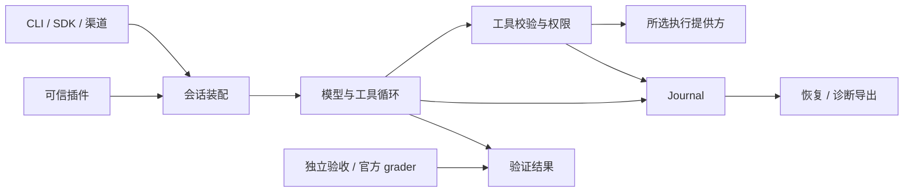

# ForgeCode 1.0.0 架构

本页说明当前实现；操作步骤见[使用指南](../install/terminal-quickstart.md)，概念、实例、源码追踪和同类产品对比见[架构 Wiki](../architecture-guide.html)。当前工作和最近验证在 [progress.json](progress.json)，历史记录从 Git 和冻结证据读取。

## 0. 定位与组合

ForgeCode 是轻量、可扩展的 Python Agent Harness。Coding Agent 与终端是默认应用；Personal、Robot 等领域通过插件组合相同内核，各领域适配另行验证。基础 SDK 提供模型/工具循环、权限、上下文、会话、取消和 Journal，不依赖工作区、Node、CLI、YAML 或具体模型 SDK。

`AgentDefinition` 选择能力，`SessionOptions` 选择运行参数和执行边界，`RunProfile` 选择入口及可选路由。普通 coding 默认宿主 `danger-full-access` + `never`；core 没有仓库上下文、任务管理、检查点、命令作业或工作区执行锁。

coding 的 `features` 可选择 tasks、repository、skills、hooks、mcp、checkpoints；工具在构造前按 `tools` 筛选。仅含支持后台命令的工具时创建 CommandJobs。strict 完成策略需要 tasks/repository；普通回合无强制全盘扫描、自动检查点、独立意图路由或完成门禁。

保留单仓库和单 Python 分发包，模型、CLI、coding、MCP、观测、渠道、验收和 benchmark 依赖按 extra 安装。插件复用唯一 PluginHost，不为每个领域新增循环、日志系统或依赖注入容器。Docker 不参与日常 SDK/CLI 安装和运行。

## 1. 内核与调用链

| 模块 | 职责 |
|---|---|
| `forge/agents.py`、`api.py`、`runtime/factory.py` | 配置、会话 API 与唯一运行时装配 |
| `runtime/agent_loop.py`、`runner.py` | 会话操作与单一模型/工具循环 |
| `runtime/state.py`、`tool_types.py`、`messages.py` | 模型事件、工具契约、结果与多模态消息 |
| `runtime/executor.py`、`tool_batch.py` | 参数、授权、Hook、派发与有序结算 |
| `context`、`sessions` | 请求窗口、压缩、Journal、队列与恢复 |
| `tools`、`tasks`、`skills` | 可组合的 coding 能力 |
| `plugins.py`、`development.py`、`validation.py`、`delivery.py` | 可信扩展、自然语言开发、独立检查与交付 |
| `permissions`、`execution.py`、`sandbox` | 审批和可选执行提供方 |
| `workers.py`、`release/processes.py` | 文件/进程 worker 与真实进程所有权 |
| `cli.py`、`terminal.py`、`terminal_input.py` | 终端消费事件、输入与屏幕管理 |
| `benchmark`、`evals` | 官方基准与本地夹具的独立判分 |
| `application`、`engine` | 旧 RPC、SQLite 和历史读取兼容 |

CLI/API 使用 `open_runtime → create_runtime → Conversation.stream → TurnRunner → ToolExecutor`。模型提供方按需导入。ModelStartup 持有构造中的客户端；失败时关闭，成功后把资源交给 Conversation。旧 Engine 不参与普通 CLI/SDK/benchmark 运行；旧 worker 子命令委托 `forge.workers`。共享 ID、JSON 编码和外部操作期限也不依赖旧控制面。

模型循环先提交用户消息和请求快照，再消费流。文本、思考和工具参数立即转发；完整响应通过协议检查后才执行调用。ToolExecutor 统一执行 prepare/dispatch/finish，不能通过其他路径绕过授权、版本检查、Journal 和清理。

批次使用有界滚动池，默认最多 10 个执行体。权限、前置 Hook 和结算按模型顺序进行，显式声明安全的工具体可并行。未声明、分类异常、无效参数和单次提权独占；读写组之间有屏障。普通工具错误继续反馈，拒绝、取消和不确定副作用停止补充并收齐已启动调用。模型看到的结果仍按调用顺序排列。

文件修改在同一后端持有目标租约，规范路径、别名/已有文件身份和缺失父目录参与协调。多文件补丁一次预留全部目标，直到写入、观察与结算结束才释放。独立文件可并行，同文件或别名串行；该机制不覆盖任意 shell 程序的内部写入，也不是跨进程文件事务。

后台命令复用原工具校验、后端和单次审批。启动结果只表示受理；CommandJobs 保存所属回合、输出游标和终态，超出并发上限时排队。`job_output` 区分等待新输出与等待完成，单次最多 3600 秒并受调用方截止时间约束；旧输出不会让完成等待立即返回。`job_kill` 只能取消当前会话作业。有限命令阻止验证及完成；显式 `lifetime=session` 服务允许验证，并在完成回答后继续由会话持有。两种完成入口采用相同规则，活跃作业仍阻止权限/历史切换。退出清理所属资源，跨进程恢复不重放命令。

会话服务首先支持 Windows/Linux full-access 提供方；`timeout_seconds=null` 仅用于显式会话服务，普通命令仍有操作期限。Linux 评测服务使用文件输出和进程身份回执，由 supervisor 只移交自身接管且身份匹配的服务子树；官方 Agent 到期可保留这些服务供 verifier 使用，用户取消评测则清理。环境销毁负责最终回收，移交不冒充进程已退出。

主动停止一个作业与取消整个回合分别处理。执行提供方返回本次操作的清理证据；确认进程已停止的 `job_kill` 允许回合继续，并提醒可能留下部分文件。清理未知仍为 indeterminate；停止进程不代表回滚文件，写操作中断也不凭进程退出推断写入完整。

调用方可提供单调时钟截止时间；评测从官方期限扣除既有清理预留后传入，内核展示剩余时间并限制单次作业等待，不另设累计预算。临近截止时每轮提醒一次，CLI 默认不设截止时间。coding 上下文读取 CPU affinity 与 cgroup v1/v2 的 CPU/内存上限，未知值保持未知；POSIX 字符串命令明确使用 `/bin/sh`。

## 2. 数据、扩展与边界

### 模型与上下文

ModelClient 和协议错误属于 `runtime.state`，不通过 Anthropic 实现获取通用类型。Anthropic、Chat Completions、Responses 和 Gemini 适配器输出相同事件；Chat 流解析在 `runtime/chat_stream.py`，输入转换与 OpenAI 轨迹导出共用实现。

Anthropic 原始事件按顺序拼接 thinking、signature、text 和 tool_use。完整且通过校验的提供方状态随 Journal 保存，只向同模型/提供方续传；模型切换使用可移植消息投影。中断、截断或协议错误不发布可续传状态，历史丢失的数据不补造。

传输默认最多两次重试，SDK 内部重试关闭。连接、超时、限流和服务端错误仅在尚未发布语义输出时自动重试；正文、思考或工具调用后不透明重放。有效 Retry-After 优先，超过 60 秒停止自动重试；否则使用可取消的抖动退避。显式协议修复/输出续写的次数独立限制，不恢复已取消副作用。

请求失败记录脱敏且有长度上限的 HTTP 状态、提供方请求 ID、错误类型/代码/参数/摘要，不转存请求正文或认证头。普通 coding 的检查上下文保留执行结果与时效事实，不因时效变化自动要求重跑；显式严格验收仍检查当前证据。

ContextManager 负责请求窗口、内容归档和压缩，仓库规则/记忆是可选 RepositoryContext。系统提示保持稳定，当前任务、工具和动态事实在请求末尾加入。coding 按访问路径加载 AGENTS.md/FORGE.md 与相关规则；新规则需进入下一次模型请求，之后才能重试相应写入。

默认窗口 262,144、输出上限 65,536 tokens；总预留 49,152，近期原文约 20,000。实际输出额度按剩余窗口与估算余量缩小。大工具结果超过 8,192 字符时保留头 4,096 和尾 1,024，完整原文留在受限 artifact 和 Journal。图片与工具配对保持完整。估算不冒充提供方精确计费。

Harness 没有累计模型次数、工具次数、token 或回合总时长预算。TurnState/ObservedModelClient 只记录实际用量；单次命令默认 120 秒且可显式延长，网络超时、取消、模型容量与评测器期限独立保留。六个旧循环参数仅兼容接收并警告，不生成状态或校验值。

### Journal、恢复与导出

Journal 是默认执行事实源，CLI/SDK 不再自动写第二份 trajectory。模型输入快照可按摘要重建；正文/思考/参数增量实时显示、分批落盘，终态、重试、取消及消费者关闭排空缓冲。授权和工具执行事实保持同步持久化。突然硬退出可能丢失最后尚未落盘的诊断分片，不能据其缺失推断工具未执行。

完整工具结果在上下文裁剪前记录，大载荷使用带摘要的外部 payload。会话、回合、请求、调用和后台作业保留各自身份。未知用量保持未知；已取消、失败或不确定的执行不会被“恢复”改写为成功。

SessionStore 从 Journal 重建历史，写入使用父记录/序号检查，防止多个写入者分叉。steering 只在请求边界消费，follow_up 等待下一轮；取消后未消费输入保留。检查点是显式 coding 能力，恢复文件仍检查权限和版本，不自动重放历史工具。

ATIF v1.7 与 OpenAI messages JSONL 均为离线脱敏投影，包含失败、取消、部分响应和未知结果。原 Journal 不修改。新建/恢复事件记录产品版本；ATIF 区分记录版本、mixed/unknown 与当前导出器版本。旧 TrajectoryRecorder 可显式使用。蒸馏、SFT/DPO、tokenizer 和训练执行已移除。

后台作业的启动、跨回合保留、取消及移交也进入导出。OpenAI 元数据按 `origin_turn_id` 关联原始调用，ATIF 保留生命周期事件；有活跃作业时记录未闭合，已移交服务单独列出，不能把移交误记为进程退出。

### 插件、工具与交付

PluginHost 只加载明确受信任的 Python 插件，按依赖顺序启动，失败撤销，逆序关闭资源。PluginContext 支持工具、服务、模型/执行提供方、Hooks、子任务和完成检查。ToolContract 不要求根路径；文件修改元数据是具体工具的可选能力。插件工具仍走 Executor，可信宿主 Python 不属于原生沙盒覆盖范围。

Hooks 保留匹配规则、JSON 协议和有界输出，外部进程由 LocalProcessOwner 管理。MCP 管理自己的连接与进程；取消、输出超限和清理失败不能返回虚假的 allow。Skills 逐步加载资源，YAML 依赖仅属于 coding extra。消息渠道作为可选受管服务接入同一会话。

自然语言开发复用严格 coding 回合。固定验收由控制器持有；候选代码、配置、自测和独立业务检查分别判断，不能通过修改验收预期自证成功。完成后不自动启用。交付包包含显式源码、AgentDefinition、依赖 pins、匹配 SDK wheel 和验收；导入不安装、不执行、不信任旧回执，新环境需重新 check。

### 权限与可选沙盒

权限预设同时描述执行模式和审批。普通 coding 默认宿主执行；受限模式使用所选提供方，失败不回退。切换只在空闲时准备新资源，确认旧资源清理并持久化一条组合事件后发布状态。受管子任务继承父权限，不能换更宽的提供方。

内置提供方复用 DSH sandbox-local/subprocess-local 0.2.1-alpha.1。文件 helper 做可信路径策略，命令/Git/verify 按需启动原生 runner；不在 CLI 启动时遍历所有目录或修改 ACL。Windows 原生 workspace-write 仍需要 WRITE_OWNER 和 DSH 的 ACL/完整性标签授权；Linux runner 由 DSH 选择。完整读取、网络和硬资源隔离仍未完成，strict 强隔离准入保持拒绝。

文件实际目标按模式检查，链接/Junction 不触发全工作区启动拒绝。单次扩大权限需明确理由和 allow_once，快照、执行与观察共用临时后端；完成后关闭，不改变会话模式。既有 deny、显式任务范围、环境凭据过滤与工具自带策略继续生效。清理未知返回 indeterminate 并保留现场，不主动重放。

## 3. 评测与验证

公共基准通过 `benchmark.harbor.platform` 冻结任务、源码、模型、插件、完成策略和条件，再走同一 Harbor runner。默认官方预构建镜像、一次尝试、零任务级自动重试、独立官方 grader。缺少镜像/资源保持未验证，不自动构建预热镜像。旧 Aider 反馈修复入口单独兼容，不能与无外部反馈协议混报。

Harbor 任务并发与环境准备并发分别冻结；准备默认最多 4 道，涵盖建容器、健康检查和 Agent 安装。复用现有 job 插件在准备前排队，排队不消耗官方阶段期限，准备结束或取消立即释放槽位。Agent 与判分仍受 Harbor 总任务并发约束。Docker 查询按完整输出和 60 秒操作期限执行；查询错误独立于官方阶段超时，避免把短查询失败误报为环境运行了 600 秒。

容器中的评测入口也经 `open_runtime` 装配 full-access/never 执行策略和文件提供方，不使用未配置的旧权限路径。evaluation Profile 不加载机器上未冻结的权限规则、目录 Hooks 或 MCP；显式冻结的插件仍由同一 PluginHost 加载和关闭，模型配置在装配前后均与冻结输入核对。

新运行默认 normal，严格完成检查必须显式选择；旧冻结配置缺少字段时保留原 strict 语义。RunSpec 旧预算字段只供归档读取，新计划拒绝它们；有预算的历史实验应使用其原源码，不能在当前版本忽略预算后冒充同条件复测。

`evals.runner` 使用 HarnessSession 和共享模型配置。它的 Agent 与独立 verifier 默认 workspace-write，运行前显式预检原生进程边界；这不同于普通 CLI 的默认宿主执行。setup、公开/隐藏测试和 diff check 属于独立判分，受各自命令期限约束。最终成功以独立结果为准，Agent 的完成声明不等于测试通过。

结果保留全部尝试、基础设施错误、未判分项、真实时间和已知用量小计；缺少用量不填零。清理仅针对拥有记录的资源，未知清理不删除可能仍有活进程的工作区。公开测试轨迹标记 evaluation-only，历史成绩不能归为 1.0.0 成绩。

开发验证按变更范围执行，稳定后运行相关回归一次；CI 覆盖 Windows、Ubuntu 22.04/24.04、最小 SDK/第二环境插件交付与依赖检查。架构检查阻止内核依赖 CLI/旧控制面及提前加载可选领域模块；公共消息、工具、模型事件、Agent 配置和运行时绑定进入类型检查。

确定性实现验证、原生平台验收、安装包验证和真实模型实验分开报告。完整 OS 隔离、macOS 原生接入、真实领域适配和新模型评测不因发布版本号而获得通过结论。

## 4. 核心调用链与证明边界

执行事实来自 Journal，模型摘要不改变它；调用方验收来自独立检查，不能由最终文案替代。DSH/pi 的复用边界与许可见 [THIRD_PARTY_NOTICES](../../THIRD_PARTY_NOTICES.md)。工程实现和历史贡献以实际 Git 提交为依据。
